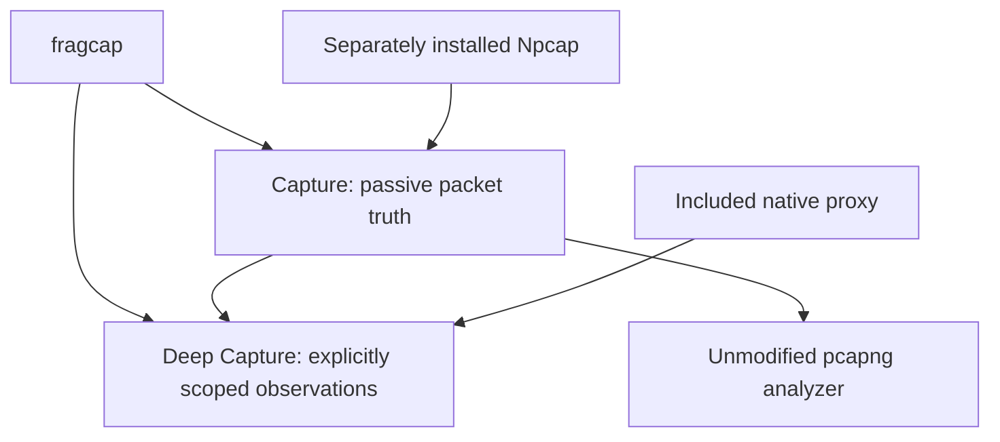

Published baseline: [v0.11.2](https://github.com/h8rt3rmin8r/fragcap/releases/tag/v0.11.2).

<Callout title="Release and completion status">
These instructions describe the published v0.11.2 workflow. Ordinary Deep Capture scopes inspection to the final game and records compatibility evidence during capture without a separate calibration command. Installed ESO behavior remains unverified; the [Native product contract](/docs/reference/native-documentation) records the published support boundary.
</Callout>

Capture passively records packets and attributes flows to processes. Deep Capture runs Capture beside an explicit, target-scoped local proxy and adds application observations for eligible traffic reaching that proxy. Start either mode for a stored target; Deep Capture records its own compatibility evidence.

## Before you begin

Live packet recording requires Windows, an elevated terminal, and separately installed Npcap in WinPcap API-compatible mode. The native Deep Capture proxy is included. The v0.11.2 release uses the signed direct-socket route for the final game's TCP and supported UDP traffic in ordinary Deep Capture. Neither mode reaches inside the target process. Do not configure a system-wide proxy, disable certificate verification, or attempt to bypass pinning.



Npcap supplies live packets, while attribution uses Windows socket and process evidence. Wireshark is an optional analyzer and can install Npcap. fragcap never bundles or redistributes Npcap. See the [dependency model](/docs/glossary/platform-and-distribution#dependency-model) and [security and privacy guide](/docs/guides/security-and-privacy).

## 1. Install fragcap and its prerequisites

Download the installer or portable archive from the [official releases](https://github.com/h8rt3rmin8r/fragcap/releases), and verify its accompanying SHA-256 checksum. The MSI adds fragcap to `PATH` and provisions the installation CA; the portable archive runs from its unpacked directory and requires a separate elevated `fragcap ca install` before Deep Capture. The MSI and fragcap executable are unsigned. The v0.11.2 release bundles a separately signed upstream WinDivert driver and needs no separate WinDivert installer. A checksum checks consistency with the published download, not publisher authentication. Review an Unknown Publisher warning deliberately rather than disabling Windows protections. See [packaging and migration](/docs/guides/packaging-and-migration).

If installing Npcap through Wireshark, leave **Install Npcap** selected and enable **WinPcap API-compatible Mode** in the Npcap installer. Loopback support is supplied by current Npcap installations.


## 2. Verify the environment

Open a terminal and run:

```powershell
fragcap doctor
```

Doctor is read-only: it starts no capture, proxy, target, or trust change. It reports separate Capture and Deep Capture readiness, environment and driver checks, and native resource ownership and recovery guidance. Unavailable and indeterminate are not ready. Healthy completed history or deliberately retained sensitive evidence is not automatically stale residue to delete. Do not expect a universal synthetic all-green report.

| Action | Administrator required? | Reason |
| --- | --- | --- |
| `doctor`, `ca status`, help, targets, and extcap queries | No | Read-only or current-user data. |
| `extcap install --user` and `extcap uninstall --user` | No | Writes the current user's Wireshark directory. System or custom protected directories require permission to write there. |
| Live `capture`, Wireshark extcap `--capture`, and Deep Capture | Yes | The live Npcap packet path checks elevation. |
| `ca install`, `ca repair`, `ca remove` | Yes | Changes the LocalMachine installation CA. The MSI performs its own install-time CA setup. |
| v0.11.2 game-scoped `deep-capture` | Yes | Opens the exact packaged WinDivert driver after authorization. |

Review named remediation first. `fragcap doctor --fix` is the individually confirmed action runner, not permission to repair everything. Re-run plain Doctor afterward. Optional `fragcap extcap install` adds a Wireshark source but is not required for command-line Capture. See [Doctor and troubleshooting](/docs/guides/doctor-and-troubleshooting).

## 3. Find a target

```powershell
fragcap targets
```

This command discovers installed titles, registers new findings in the effective local store, and lists stored targets. Ready targets precede targets needing setup. A row number is an ephemeral selector for that listing; the handle is stable. Capture readiness, engine detections, and sensitivity coverage do not establish Deep Capture compatibility. Do not substitute a Steam app identifier for a row number in `capture`.

If a target is missing, inspect `fragcap targets add --help` or `fragcap targets scan --help`. Managed stores have defaults; database flags are deliberate overrides.

## 4. Run the first Capture

```powershell
fragcap capture 1 --duration 5m --out first-capture.fcapng
```

Start the target after Capture arms, or use an eligible prepared managed launch with `--launch`. Default `target` scope writes only packets bound to selected target roles. Unattributed and other-process exclusions have separate counters. Select `--scope all` only when deliberately retaining all acquired traffic with attribution state preserved.

Payload is retained by default for admitted packets. `--no-payload` selects metadata without packet payload bytes; it does not establish whether omitted bytes were encrypted. Capture does not decrypt traffic. Review `fragcap capture --help` and [Capture modes](/docs/guides/capture-modes) before changing modes or sinks.

## 5. Open the packet truth

Open `first-capture.fcapng` with an unmodified pcapng-aware analyzer. Process image, role, stage, direction, and attribution fidelity appear in standard packet comments. Ignoring annotations still leaves ordinary readable pcapng. Loss accounting describes acquired, omitted, dropped, and refused traffic rather than equating an empty trace with success.

This completes the passive first-run path. Continue only for deliberately selected, authorized local inspection.

## 6. Start Deep Capture

Select a stored target whose final game executable and managed launch are known:

```powershell
fragcap targets show sample-target
fragcap deep-capture sample-target --launch --duration 5m --har
```

The ordinary v0.11.2 path prepares one exact plan, then waits for authorization before effects. It launches through the stored platform or publisher chain, gives those launchers no Fragcap proxy URL, and routes eligible final-game sockets through the direct route. `--inspect-scope auto` resolves to the final game. It requires Administrator and the packaged direct-route component on Windows. No prior positive calibration fact is required; each capture records routing, protocol, process, loss, and cleanup evidence.

If the target is missing or has no reliable final-client declaration, use `fragcap targets add --help`, `fragcap targets scan --help`, or `fragcap targets show` to inspect and author it. A title or launch hint alone does not prove which executable is the game. If a stored Steam root moved, `fragcap targets relocate --steam <APP_ID>` supplies an exact relocation plan.

Explicit `--inspect-scope launch-chain` broadens inspection to managed launch roles. It uses authenticated SOCKS for launcher network traffic by default. `--launcher-proxy http-and-socks` deliberately exposes both proxy protocols. Keep the resulting launcher evidence separate from final-game evidence. A failed run remains a recorded attempt with its own bundle; it does not block a later capture because of an absent positive calibration fact.

Warm applications remain yours to close normally. `--restart-warm` observes an operator-owned close, then requires a fresh preparation and authorization. Read [Deep Capture compatibility](/docs/reference/deep-capture-compatibility) for route and traffic limits.
## 7. Review the Deep Capture plan

```powershell
fragcap deep-capture sample-target --launch --inspect-scope auto --duration 5m --har
```

Review the complete plan: target and managed launch authority, requested and effective inspection scope, blind middleware handling, exact loopback and routing policy, installation CA fingerprint and trust verification, sensitive artifacts, millisecond deadlines, fact writes, cleanup obligations, and refusal boundaries. Exact-game scope retains middleware and unresolved-owner traffic as blind relay metadata without decrypted application records or proxy-owned TLS keys. v0.10.10 requires a healthy installation CA before session effects. No listener, bundle, launch, Capture, or fact effect occurs until exact authorization. Output failure, target drift, plan mismatch, expiry, or pending prior-session recovery refuses rather than broadening scope.

When capture ends, fragcap first asks exact session-created route owners to
close through their ordinary window controls. It watches their exits and the
exits of observed helper processes while keeping the session proxy available.
The plan shows a two-minute route-owner release limit. After the shorter grace
period in the plan, fragcap can terminate only an exact owner created by this
session and proven again at the time of control. Save work before authorizing:
an automatic close or bounded termination can end the selected application.
Helpers, warm processes, and unrelated processes never receive that control.
You normally do not need to close the application yourself. If an owner or
helper remains, its identity cannot be verified, or fragcap ends unexpectedly,
the session reports partial cleanup. Close the remaining application normally,
then launch it outside the ended session before using its networked features.
The published v0.10.9 plan authorizes this automatic close sequence and
corrects a defect that could prevent its graceful request when ordinary
platform helpers remained live in v0.10.8.

Interactive execution requires a complete response line. Structured execution requires `--authorize-stdin`: read the emitted plan event and return its exact identifier plus one LF in the same process. `--quiet` and `--silent` never hide required consent output or authorize effects. Retired trust booleans do not authorize a run. Omit optional HAR or key logging when unnecessary.

Supported paths include HTTP/1.1, HTTP/2, HTTPS, WebSocket, SSE, schema-free gRPC envelopes, generic TCP/UDP, separately verified non-HTTP TLS, and scoped QUIC/HTTP/3. Support is route-, trust-, and traffic-specific, not universal. Pinning is never bypassed. See the [traffic matrix](/docs/reference/deep-capture-compatibility) and [CLI reference](/docs/reference/cli#deep-capture).

## 8. Review the bundle and cleanup

Read `manifest.json` first. Session outcome, cleanup outcome, artifact finalization/completeness, loss, and traffic inspectability are independent. A complete operation does not prove every flow was inspectable. Partial evidence must not be silently relabeled complete. [Output formats](/docs/reference/output-formats) explains manifest version 2, packet truth, application JSON Lines version 2, bounded HAR, proxy-owned client-facing TLS key logs, post-collection correlation, durable cleanup streams, sensitivity, and omissions.

Keep bundles private. Packet bytes, URLs, bodies, endpoints, process traces, and key material can expose sensitive information. `bundle export` makes a separate transformed copy with an exhaustive manifest; it does not edit the original. Sensitive cleanup is an explicit exact action, not a prerequisite to preserving legitimate completed evidence.

```powershell
fragcap doctor
fragcap doctor --fix
```

Only run the second command to review named remediation. Exact owned recovery obligations must be reconciled; ambiguous ownership does not authorize unrelated removal. Keep remaining ownership records until recovery is resolved.

## 9. Uninstall or start fresh

In v0.10.10, first installation deliberately removes identified pre-S185 Fragcap user and session state. Later ordinary uninstall removes installer-owned program effects while preserving new targets, writable stores, profiles, captures, settings, bundles, and the machine installation CA. Explicit `fragcap ca remove --fingerprint <SHA-256> --yes` removes that exact root and signer after review. See [packaging and migration](/docs/guides/packaging-and-migration) for the clean-break and later fresh-start workflows.
